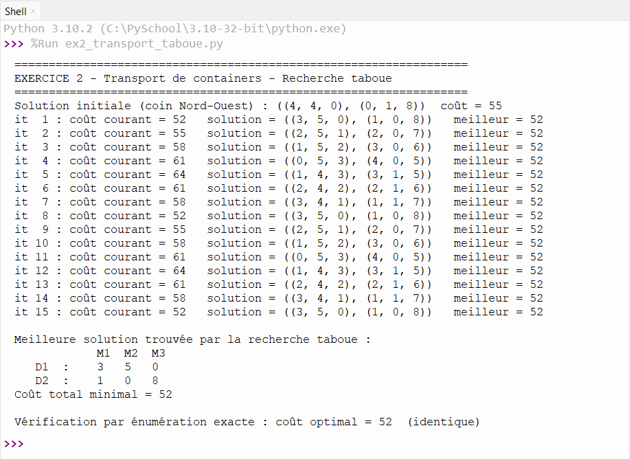
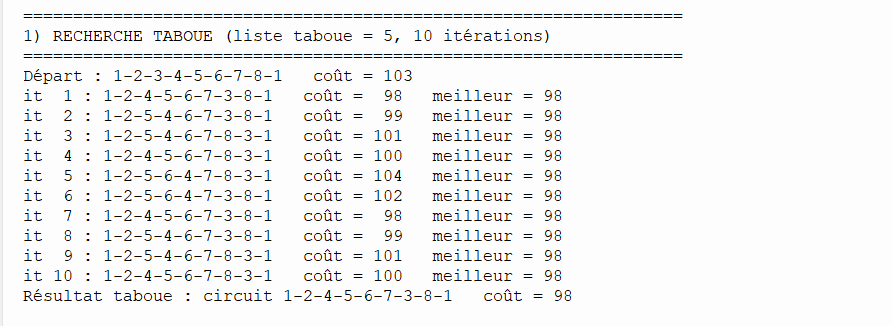
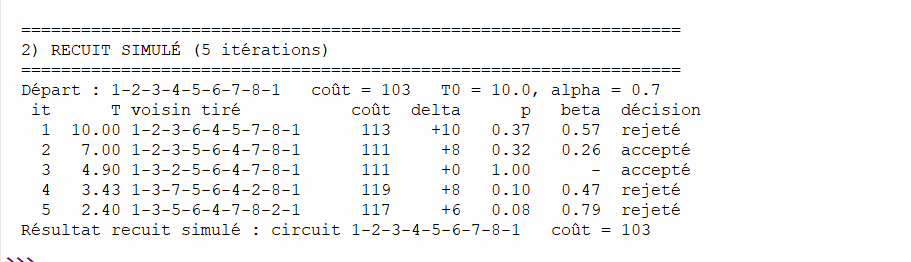

# TD Optimisation — Exercices 2 et 3

Deux programmes Python, sans bibliothèque externe :

```bash
python exercice2_transport.py
python exercice3_tsp.py
```

---

## Exercice 2 — Transport de containers (recherche taboue)

**Idée générale.** Deux dépôts doivent livrer trois magasins en minimisant le coût total de transport. On part d'une solution correcte (méthode du coin Nord-Ouest, coût 55), puis on l'améliore en déplaçant à chaque étape 1 container sur un cycle 2×2, ce qui respecte toujours les stocks et les commandes. La recherche taboue choisit le meilleur voisin, même s'il coûte plus cher, et une liste taboue de 5 solutions l'empêche de tourner en rond. Résultat : coût **52**, qui est l'optimum (vérifié par énumération exacte).

**Capture de l'exécution :**



---

## Exercice 3 — Voyageur de commerce, 8 villes

**Idée générale.** On cherche le tour fermé le plus court passant par les 8 villes, en partant de 1-2-3-4-5-6-7-8-1 (longueur 103). Les « - » du tableau sont des routes inexistantes : un tour qui les utilise est interdit. Les deux méthodes modifient un tour par l'échange de deux villes ou l'insertion d'une ville ailleurs. L'optimum, vérifié par énumération, est **98**.

### Question 1 — Recherche taboue

Même principe que l'exercice 2 : on va vers le meilleur voisin autorisé, même plus long, et on mémorise les 5 derniers tours visités pour ne pas y revenir. Elle trouve **98** (1-2-4-5-6-7-3-8-1) dès la première itération.

**Capture :**



### Question 2 — Recuit simulé (5 itérations)

On tire un voisin au hasard. S'il est meilleur, on l'accepte ; sinon on l'accepte quand même si p = exp(−delta/T) est supérieur à un nombre aléatoire beta. La température démarre à 10 et baisse de 30 % à chaque itération, donc l'algorithme accepte de moins en moins de dégradations. Avec seulement 5 itérations, le résultat reste **103** : il dépend du hasard et il faudrait plus d'itérations pour atteindre 98.

**Capture :**

